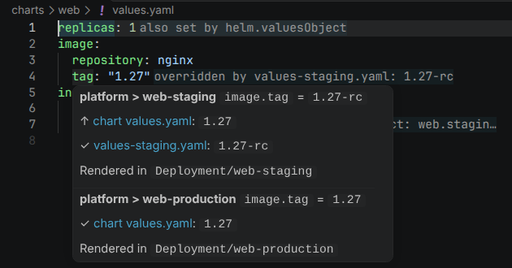

# Helm Values Lens

Helm Values Lens shows in VS Code, next to each line of a values file, the value that the Helm chart ends up with.
A value often gets set in several files, such as the chart's `values.yaml`, a `values-production.yaml` and the Argo CD Application that deploys the chart.
Each of these files adds a layer of values.
The last layer wins.
The hint names that layer and its value.

The extension reads which files feed a release, and in which order, from the files of the tool that deploys the chart: Argo CD, Helmfile, Flux or Kustomize.
A repository that deploys with one of them needs no settings.



## What it shows

- Next to a value in a values file: the layer that overrides or deletes it, with the final value (`overridden by values-staging.yaml: 1.27-rc`).
- Next to a value that a later layer sets to the same value: `also set by helm.valuesObject`.
- Next to a value equal to the chart default: `= chart default`.
- A warning on a key that no chart reads, such as `imgae.tag: read by no chart, ignored by web.`
  Such a key changes nothing in the release and most likely carries a typo or an outdated name.
  Where a release that takes the file did not load, the warning drops to a note, since the extension cannot tell whether its chart reads the key.
- Three faint dots under a key that the charts of some releases read and the charts of others ignore, such as a key of a shared `globals.yaml`: `global.tracing: read by api, ignored by web.`
  The hover of each release that ignores it names its chart.
- Next to each `.Values` read in a chart template: the final value of the release.
- On hover over a key or a `.Values` read: every layer of each release that reads the file, lowest first, each linked to its line.
  The hover covers the one path under the cursor, in a values file, in the values block of an Application and in a template alike.
  A mark names what became of the layer's value: final, same as final, overridden, replaced, deleted or not set.
  The layer of the open file shows its name in green, without a link.
- In the same hover, after a render: the rendered resources whose text holds the value.
  A chart default with the same text matches as well.
- A quick fix on a key equal to the chart default, which removes it or every such key of its values file or values block.
  A chart upgrade that changes the default then reaches the release.
  The key itself stays valid: three faint dots under it mark the fix, with no warning.
- A quick fix on a key that no chart reads, which renames it to a key of the chart a typo away or removes it.
- A quick fix on a key that some charts ignore, which moves it to a values file that only the releases reading it take.
  The fix shows up where such a file exists and the move leaves the final values of every release unchanged.
- An error on a key whose final value the `values.schema.json` of the chart rejects, such as `replicas must be >= 1`, where `helm template` would fail.
  The schema of a dependency checks the values under its key.
  A value that no file sets, such as a missing required key, gets its error on the map around it or on the release.
- In the hover of a key: the description, the type and the allowed values from the schema.
- Suggestions while you type a key in a values file or a values block: the keys that the chart defaults, reads in a template or names in its schema.
  Each suggestion shows the description and the default of its key.
  After `key: `, the suggestions hold the values that the schema allows, `true` and `false` for a boolean and the chart default.
- On hover over the line that names a release, such as `metadata.name` of an Application: its chart and its values layers.
- Above the release in its Application, Helmfile, HelmRelease or kustomization: the chart, the number of values layers, a link to the files of the chart and the state of the last render.
- A problem marker on the release where its chart could not be loaded or `helm template` could not render it.


## Use

Open the folder that holds your deployment files.
The extension finds the releases, loads their charts and renders each one with `helm template` in the background.
Each render stays on disk in the extension's storage for the workspace.
After a restart or a save, helm renders the releases whose values files or chart changed.
Every other release takes its render from disk.
Hints update while you type.
The status bar names the resources that a save changed.
While the extension reads or renders, the status bar counts the releases done, such as `Reading releases 12/40`.
The output channel `Helm Values Lens` logs each step with its time: the releases read, each chart download and the renders, with how long each took.
To see each chart read and each render as well, run `Developer: Set Log Level` and pick `Debug` for `Helm Values Lens`.

A chart download that failed, such as one from a registry out of reach, fails again without a new try for an hour, across restarts of VS Code.
To try every failed download again, run `Reload Releases`.

One values file often feeds several releases, such as one chart deployed to staging and production.
The status bar names the release whose values the hints show, with the number of releases that read the file.
To pick another release or all of them, click it or run `Helm Values Lens: Select Release for Hints`.
Releases of the same name carry the folder that tells them apart, such as `platform (staging) > web` and `platform (production) > web`.


To apply a quick fix, click the lightbulb next to the key or press `Ctrl+.` on its line.
The fixes work in values files and in the `helm.values` and `helm.valuesObject` blocks of an Application.

The commands, under `Helm Values Lens:` in the command palette:

| Command                                     | Effect                                                                                                   |
| ------------------------------------------- | -------------------------------------------------------------------------------------------------------- |
| `Show Final Values`                         | Opens the merged values of a release, each line commented with the file and line that set it.            |
| `Show Rendered Manifests`                   | Opens the output of `helm template` for a release.                                                       |
| `Render Release`                            | Renders one release again.                                                                               |
| `Open Chart File`                           | Opens a template or values file of the chart, from the chart cache where it lives outside the workspace. |
| `Select Release for Hints`                  | Lets you pick the release whose values the hints show.                                                   |
| `Add Release from a Chart and Values Files` | Adds a release to the `helmValuesLens.releases` setting.                                                 |
| `Reload Releases`                           | Reads every release and chart again and downloads each chart whose download failed.                      |

The trace of a release lists each value with the layers that set it.
To print the trace of each release without VS Code, run `npm run trace -- <folder> [release]`.

## How it orders the layers

Each tool hands Helm the values of a release in its own order, the last layer winning.
For Argo CD:

1. the defaults of each dependency under its alias, then the defaults of the chart
2. `helm.valueFiles`, in their order
3. `helm.values`, or `helm.valuesObject` once both are set
4. `helm.parameters`, as `--set` and `--set-string`

Helmfile puts `values` before `set` and `setString`.
Flux puts `valuesFrom` without a `targetPath` before `values` and the ones with a `targetPath` after.
Kustomize merges `valuesInline` into `valuesFile` as `valuesMerge` says, then adds each of `additionalValuesFiles`.

A map merges into the map below it key by key.
A scalar or a list replaces whatever sat at its path.
A `null` deletes the key.
A dependency whose `condition` or `tags` turn it off contributes no defaults.
The test suite compares the merged values with the `COMPUTED VALUES` of `helm install --dry-run=client` for each release.
Where `helmfile` and `kustomize` sit on the `PATH`, it compares with their output as well.

## Where it works

| Setup                        | What gets read                                                                                                                                                |
| ---------------------------- | ------------------------------------------------------------------------------------------------------------------------------------------------------------- |
| Argo CD Application          | One source or `sources`. A chart from a Helm repository, an OCI registry or a folder. `$<ref>/<path>` values files.                                           |
| App of apps                  | The Applications in the `helm template` output of a chart, nested a few levels deep.                                                                          |
| Argo CD ApplicationSet       | The `list`, `git`, `matrix` and `merge` generators. Generators that read state outside the repository, such as `clusters` or `pullRequest`, yield no release. |
| Helmfile                     | `helmfile.yaml` and `helmfile.yaml.gotmpl`. One release per environment where the environments render it apart.                                               |
| Flux HelmRelease             | A chart from a HelmRepository, GitRepository, OCIRepository or HelmChart. `valuesFrom` ConfigMaps and Secrets from the repository or a kustomize generator.   |
| Kustomize                    | `helmCharts` with `valuesFile`, `valuesInline`, `valuesMerge` and `additionalValuesFiles`.                                                                    |
| A chart that nothing deploys | One release with the chart defaults. One more per `values-<name>.yaml` beside its `values.yaml`.                                                              |

For any other order, add a release to the `helmValuesLens.releases` setting.

A repository URL resolves to a folder of the workspace in this order:

1. the `helmValuesLens.repositories` setting
2. the Git remotes of each checkout
3. the one folder whose path ends with the path of the URL

Charts from a Helm repository or an OCI registry get pulled once per version into the extension's storage.

These stay out of the trace:

- A values file by URL.
- A parameter setting a list item (`list[0].name`).
- The globals that Helm copies from a parent into its dependencies at render time.
- Helmfile `secrets`.
- Helmfile template expressions beyond `.Environment.Name`, `.Release.Name` and `.Release.Namespace`.
  A layer holding another expression shows a warning on the release.
- Flux `valuesFiles` that leave out `values.yaml`: Flux then drops the chart defaults, which the trace keeps.
- A list of maps under Kustomize `valuesInline`, which Kustomize merges by a key such as `name`.
  The trace replaces it whole.
- A `$ref` to another file or a URL in a `values.schema.json`.
  The release shows a warning.
  That schema checks nothing.

## Install

`helm` must sit on your `PATH`, or `helmValuesLens.helmPath` must hold its path.
Build the extension and install it:

```sh
npm install
npm run package -- --out helm-values-lens.vsix
code --install-extension helm-values-lens.vsix
```

## Settings

| Setting                              | Default | Effect                                                                                               |
| ------------------------------------ | ------- | ---------------------------------------------------------------------------------------------------- |
| `helmValuesLens.helmPath`            | `helm`  | The binary that pulls and renders the charts.                                                        |
| `helmValuesLens.hover.showAllLayers` | `true`  | Lists every values layer of the release in the hover, the ones that leave the key alone included.    |
| `helmValuesLens.renderOnSave`        | `true`  | Renders each release with `helm template` once the workspace opens and after each save.              |
| `helmValuesLens.releases`            | `[]`    | Releases that no deployment file describes, each a chart folder with its values files, lowest first. |
| `helmValuesLens.repositories`        | `{}`    | Repository URLs mapped to folders, for a checkout whose remote and path name neither URL.            |

A release in the setting, with paths relative to the first workspace folder:

```jsonc
// .vscode/settings.json
{
    "helmValuesLens.releases": [
        {
            "name": "web-staging",
            "chart": "charts/web",
            "valueFiles": ["charts/web/values-staging.yaml", "overrides/staging.yaml"],
            "set": { "image.tag": "1.28" }
        }
    ],
    "helmValuesLens.repositories": {
        "https://git.example.com/acme/gitops.git": "gitops"
    }
}
```

## License

MIT
