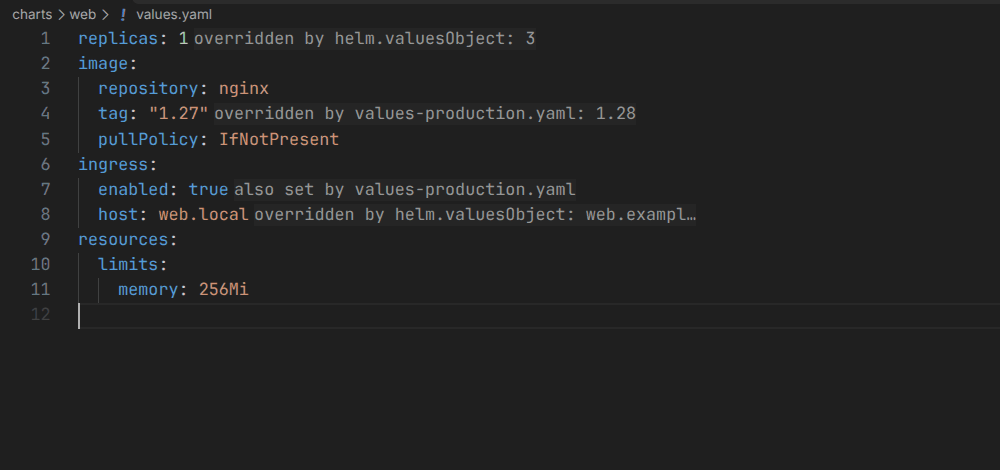
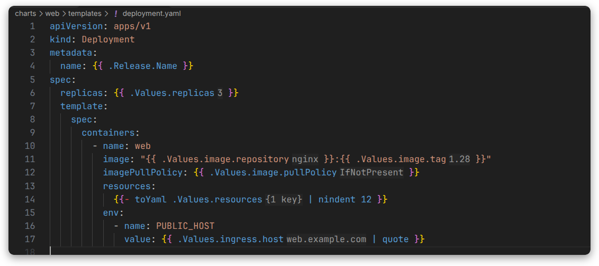
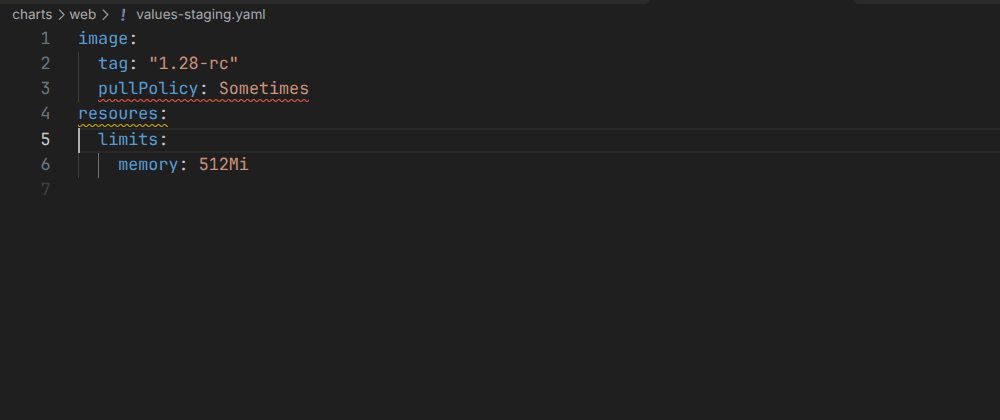
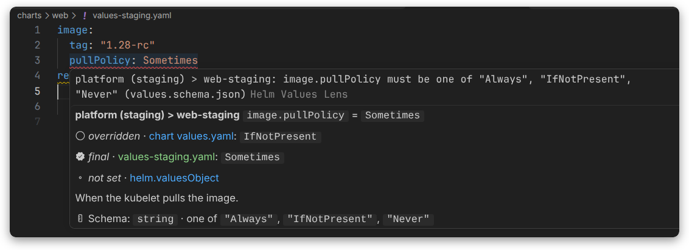
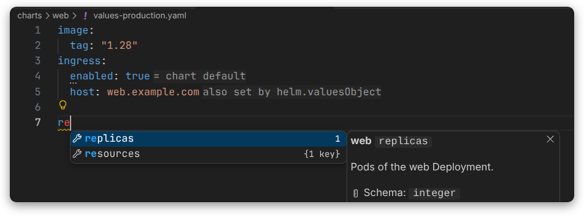
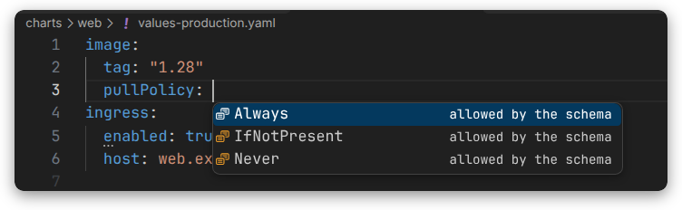
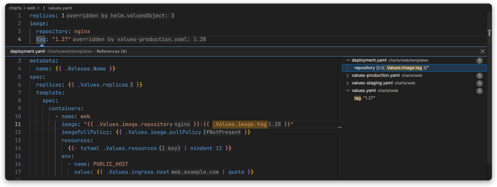
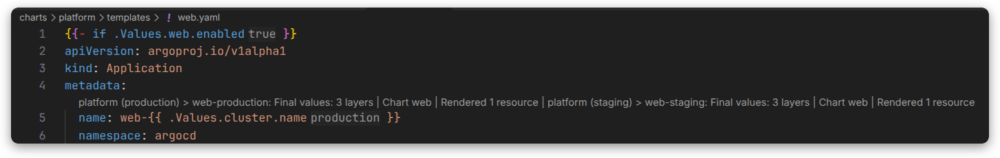
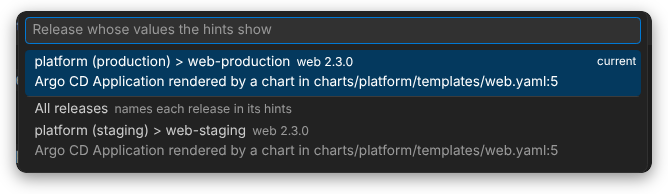

# Helm Values Lens

See next to every line of a Helm values file the value that your release ends up with.

[](https://marketplace.visualstudio.com/items?itemName=bjoern621.helm-values-lens)
[](https://marketplace.visualstudio.com/items?itemName=bjoern621.helm-values-lens)
[](https://github.com/bjoern621/helm-values-lens/actions/workflows/ci.yml)
[](LICENSE)



Hover a key to see every layer that sets it, lowest first, each linked to its line.

A value often gets set in several files: the chart's `values.yaml`, a `values-production.yaml`, the Argo CD Application.
The last layer wins.
Helm Values Lens reads the layer order from Argo CD, Helmfile, Flux and Kustomize, with no settings.

## Final values in templates



Each `.Values` read in a chart template shows the value that the release renders.

## Typos fixed in one keystroke



A key that no chart reads gets a warning and a quick fix that renames it to the key a typo away.

## Schema errors before the deploy



A value that the chart's `values.schema.json` rejects gets an error where `helm template` would fail.

## Completion from the chart





Keys and values get suggested from the chart defaults, its templates and its schema.

## Every place a key lives



`Shift+F12` lists each layer that sets a key and each template line that reads it.
`F12` jumps to the line whose value wins.
`F2` renames the key in all of them.

## Each release at a glance



Above each Application, Helmfile release, HelmRelease or kustomization: its layers, its chart files and its rendered manifests.

## One file, many releases



One values file often feeds staging and production.
Click the release in the status bar to pick the one whose values the hints show.

## Install

Search for Helm Values Lens in the Extensions view or run:

```sh
code --install-extension bjoern621.helm-values-lens
```

`helm` must sit on your `PATH`.
Elsewhere, set its path in `helmValuesLens.helmPath`.

## Where it works

- Argo CD Applications, app of apps and ApplicationSets
- Helmfile
- Flux HelmReleases
- Kustomize `helmCharts`
- A chart that nothing deploys, with one release per `values-<name>.yaml`

For any other setup, add a release to the `helmValuesLens.releases` setting.
The [reference](docs/reference.md) lists every feature, command and setting, the fields that each tool's files may use and the cases that the trace leaves out.

## License

MIT
